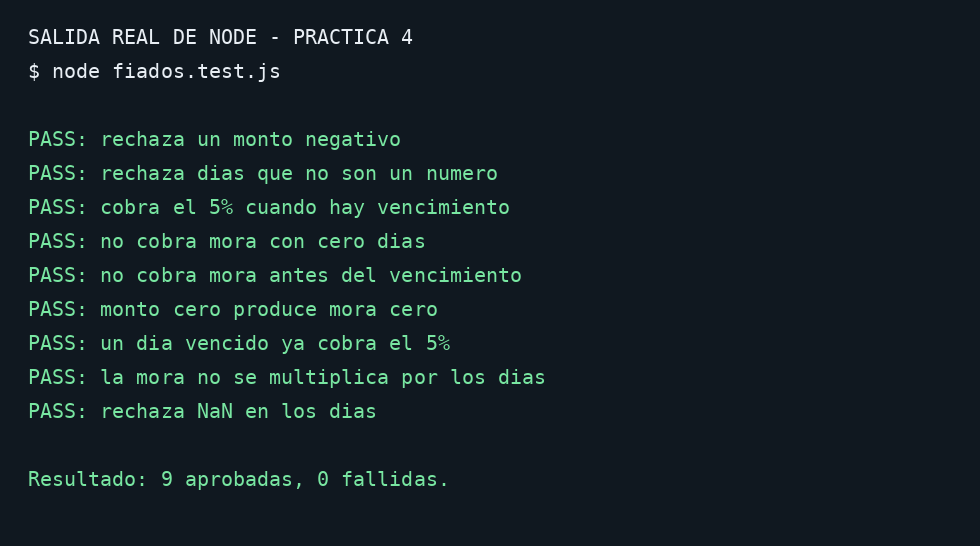

# Práctica 4 — Evidencia

## Ejecución

Desde la carpeta `practica-4`:

```bash
node fiados.test.js
```

Resultado comprobado: **9 pruebas aprobadas y 0 fallidas**.



La imagen representa la salida real capturada al ejecutar Node en el entorno de preparación; no es una captura de la terminal del estudiante. El texto original está en `salida-tests.txt`.

## Ciclo RED → GREEN

Las pruebas se escribieron antes de agregar las validaciones. La implementación inicial de `tdd/fiados.red.js` produjo 6 pruebas aprobadas y 3 fallidas; la salida real está en `tdd/salida-red.txt`. Después se agregaron las validaciones y las 9 pruebas pasaron.

## Pendiente en el repositorio

Este ZIP no crea commits, PR ni merge en `isw2-practicas`. Para cumplir completamente la consigna, hay que registrar el ciclo RED → GREEN y hacer el PR y merge en el repositorio. Consulte `README.md`.
