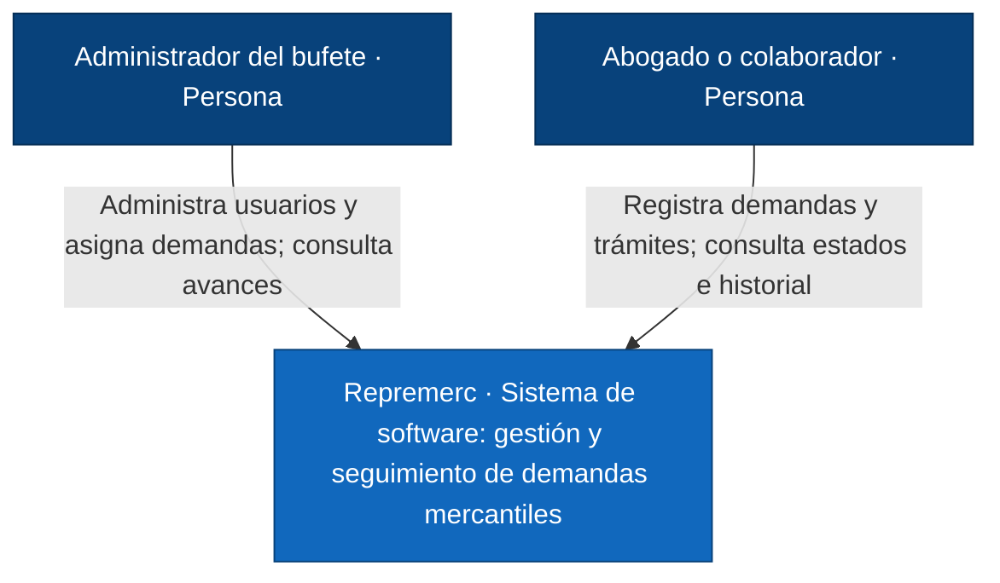
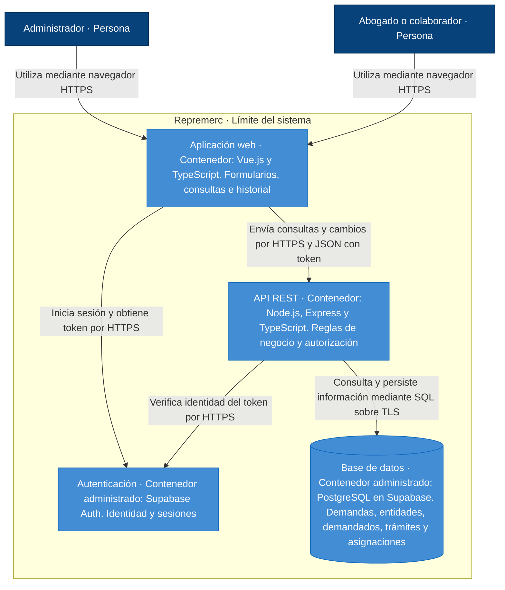

# Práctica 6: Diagrama C4 de Repremerc

**Autor:** Allan  
**Proyecto:** Sistema de seguimiento de demandas para un bufete de abogados.  
**Estado:** Arquitectura propuesta. Vue y Supabase son las tecnologías previstas; Node.js con Express se propone para el backend.

## 1. Descripción y alcance

Repremerc permitirá registrar las entidades representadas por el bufete, los demandados, los tipos de demanda, las fechas de presentación, los juzgados y los jueces asignados. También permitirá asignar colaboradores, consultar el estado de cada demanda y conservar el historial de escritos, exhortos, embargos y otros trámites.

Los usuarios serán el administrador del bufete y los abogados o colaboradores. Los juzgados, jueces, demandados y entidades representadas serán datos administrados por el sistema; en esta propuesta no tendrán acceso directo ni integraciones automáticas con el sistema judicial.

## 2. C4 nivel 1: contexto

Este nivel muestra el sistema completo y las personas que lo utilizan. Se utiliza la notación de flujo de Mermaid con los tipos de elementos C4 indicados en las etiquetas.

### Justificación del nivel 1

El sistema se presenta como una sola unidad para explicar su propósito sin entrar en detalles de implementación. El administrador organiza el trabajo y supervisa los casos, mientras que los abogados y colaboradores registran los movimientos de las demandas. Esta separación ayuda a definir los permisos de cada rol. No se incluyen servicios judiciales externos porque no se ha previsto una conexión automática con ellos. La infraestructura administrada en Supabase se detalla en el nivel 2 como parte de la solución.

## 3. C4 nivel 2: contenedores

En C4, un contenedor representa una aplicación o almacén de datos; no significa necesariamente un contenedor Docker. El límite siguiente agrupa los elementos de la solución, incluidos los servicios administrados por Supabase.

### Responsabilidades y justificación del nivel 2

| Contenedor | Responsabilidad | Justificación |
| --- | --- | --- |
| Aplicación web | Mostrar formularios, listados, estados e historial de demandas. | Vue permite organizar la interfaz en componentes reutilizables y separar la presentación de las reglas de negocio. |
| API REST | Validar datos, verificar permisos y ejecutar operaciones sobre demandas y trámites. | Centraliza las reglas, como controlar quién puede actualizar una demanda, y facilita probarlas sin depender de la interfaz. |
| Autenticación | Gestionar identidad, inicio de sesión y tokens. | Supabase Auth evita desarrollar desde cero el manejo de contraseñas y sesiones. La API sigue siendo responsable de autorizar cada operación. |
| Base de datos | Conservar entidades, demandados, demandas, juzgados, jueces, trámites y asignaciones. | PostgreSQL permite representar las relaciones y aplicar restricciones de integridad. Supabase proporciona su administración como servicio. |

La aplicación web enviará las operaciones del negocio a la API. Las credenciales de conexión a PostgreSQL permanecerán en el servidor, mediante variables de entorno. La API comprobará tanto la identidad como el rol y los permisos sobre cada demanda antes de acceder a los datos. En este diseño el acceso de negocio es mediante una conexión SQL del backend; no se presupone que Supabase Auth aplique automáticamente permisos a esa conexión.

## 4. Ejemplo de funcionamiento

1. El colaborador inicia sesión desde la aplicación web mediante Supabase Auth.
2. Vue envía a la API la solicitud para registrar un escrito, junto con el token de sesión.
3. La API verifica la identidad, comprueba el permiso sobre la demanda y valida la información del trámite.
4. La API guarda el trámite relacionado con la demanda en PostgreSQL.
5. La aplicación web recibe el resultado y actualiza el historial.

## 5. Organización y mantenibilidad

La API se organizará en rutas y controladores para recibir solicitudes, servicios de aplicación para los casos de uso, dominio para las reglas del negocio y repositorios para el acceso a datos. Esta separación permite aplicar responsabilidad única e inversión de dependencias: los casos de uso dependerán de contratos de repositorio y las implementaciones concretas realizarán las consultas a PostgreSQL.

Se podrán realizar pruebas unitarias de reglas como validar una transición de estado o comprobar si un colaborador puede modificar una demanda, utilizando repositorios simulados. Los diagramas C4 describen la estructura de la solución; la implementación y las pruebas deberán demostrar posteriormente estas decisiones.
